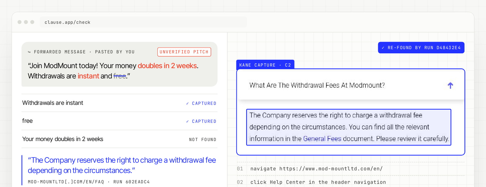
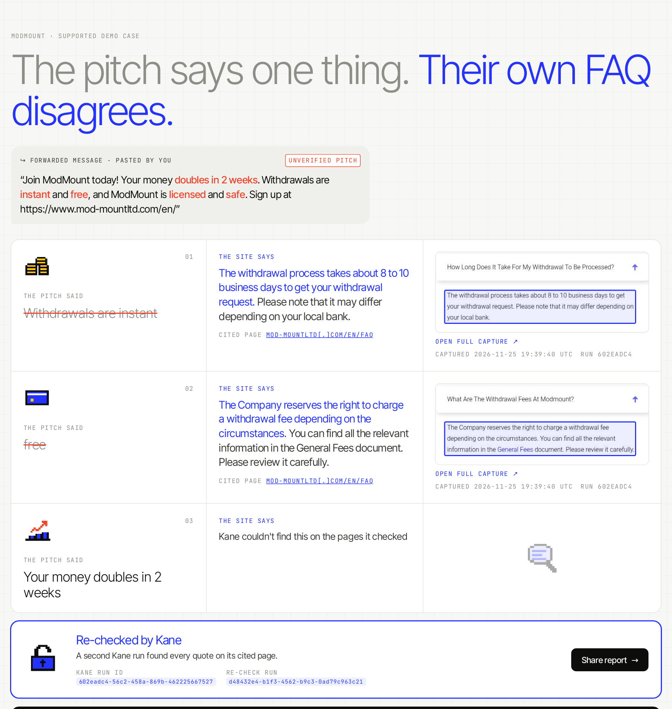

<p align="center"></p>

# Clause

**Before you send money, send Kane.** Paste an investment pitch someone forwarded you. Kane CLI opens the company's own website, finds the sentences that contradict the pitch, and brings them back with screenshots. A second Kane run re-checks every quote before you can share the report.

**[Try it](https://clause-production-795ae007.up.railway.app)** · **[Sample report](https://clause-production-795ae007.up.railway.app/case/9f177adaf5e26b5d)** · **[Judges start here](#judges-start-here)**

<p align="center"></p>

*The sample report checks a real ModMount pitch. It said "Withdrawals are instant and free." ModMount's own FAQ, read live by Kane, says withdrawals take "about 8 to 10 business days" and that "the Company reserves the right to charge a withdrawal fee."*

Kane CLI does the reading. Clause turns the pitch into separate claims ("instant", "free", "doubles in 2 weeks") and gives Kane one read-only objective: open the site, find the Help Center, expand the right FAQ answers, and store each answer word for word with its page and screenshot. The report prints only text that Kane stored itself. Anything Kane can't find reads "Kane couldn't find this on the pages it checked", never a guess. Share stays locked until a **fresh Kane run** goes back to each cited page and finds the same sentence again.

## Judges start here

About 90 seconds, no login needed:

1. Open the **[sample report](https://clause-production-795ae007.up.railway.app/case/9f177adaf5e26b5d)**. Each claim from the pitch is struck through beside the site's own sentence, with Kane's screenshot. Select a screenshot to open the untouched capture.
2. Look at the blue **Re-checked by Kane** panel. It shows the read run `602eadc4-…` and a different re-check run `d48432e4-…`. Share is enabled only because the second run found every quote again.
3. To watch Kane do it live, paste this into the box on the **[home page](https://clause-production-795ae007.up.railway.app/#paste)**. Kane takes about 3 to 5 minutes.

   ```
   Join ModMount today! Your money doubles in 2 weeks. Withdrawals are instant and free, and ModMount is licensed and safe. Sign up at https://www.mod-mountltd.com/en/
   ```

   You can watch Kane's steps arrive, then press **Re-check cited pages** on the report.

The live app runs on Railway. Each check spends real Kane credits, so the app allows at most two Kane runs at once and 20 an hour. If Kane is busy, the sample report still shows everything above.

## How it works

```
pitch ──► a language model splits it into claims, one per promise
      ──► Kane CLI reads the live site   (kane-cli run --agent, read-only)
            stores c1, c2, c3 verbatim + page URL + screenshot step
      ──► Clause binds each claim to Kane's stored text, never to model output
      ──► report: claim struck beside the site's own sentence + Kane's screenshot
      ──► Re-check: a second, fresh Kane run opens each cited page,
            looks for the passage by its opening words, stores it again
      ──► Share unlocks only if every quote is re-found on its cited page
```

- **Kane is the witness.** The quote in the report must equal the value in that run's raw Kane output (`/api/cases/<id>/kane/read.ndjson`), and the screenshot comes from the Kane step that stored it.
- **The re-check fails closed.** The re-check run must have a different run ID, end `passed`, read the cited page itself, and return text containing the original quote. If Kane cites the homepage instead of the FAQ, or stores only "true" instead of the passage, the claim is flagged and Share stays locked. Both happened during our own live testing, and Clause refused to unlock both times.
- **Read-only by design.** Kane is told never to sign up, log in, deposit, pay or download. Clause never creates accounts on a scheme's site.

## Built on Kane CLI

| Kane supplied | We added |
|---|---|
| A browser agent that navigates a real site from a plain-language objective (`kane-cli run --agent`) | Splitting a pitch into claims, and one objective per pitch |
| Verbatim variable capture (`c1`, `c1_url`) and per-step screenshots in the evidence pack | Binding each claim to Kane's exact stored text and the step's screenshot |
| NDJSON events: steps arrive live, then `run_end` with run ID and memory | The live step log in the app and the stored raw output for every case |
| Independent second runs | The re-check objective, the comparison rules and the Share lock |

## Proof

| Claim | How to check |
|---|---|
| Quotes are Kane's exact stored values | Compare the report quote with `context.memory` in `/api/cases/9f177adaf5e26b5d/kane/read.ndjson` |
| Re-check is a separate Kane run | `/api/cases/9f177adaf5e26b5d/kane/recheck.ndjson` has run ID `d48432e4-…`, not `602eadc4-…` |
| Wrong page keeps Share locked | Report **Test the lead claim against the homepage** runs a fresh Kane re-check against the homepage; the claim is flagged and Share stays disabled |
| The full journey works on a phone | `node scripts/status.mjs` runs every journey check at 390px against the live URL |

## Scope and limits

- **ModMount is the supported demo case.** Its regulator notice (SEC Nigeria, 19 January 2026) is quoted word for word in the report. Other sites work, but they have no regulator notice attached.
- Kane is an agent, and runs vary. In our live testing it sometimes joined two FAQ answers into one quote, recorded the homepage instead of the FAQ, or stored a yes/no flag instead of the sentence. Each time, Clause refused to unlock Share rather than show a doubtful quote. An incomplete re-check can be run again from the report.
- Claim splitting and the verdict per claim use a language model with a strict JSON schema: Meta Muse on the deployed app, Claude (`claude -p`) when run locally. It never writes a quote. Every quote, page and screenshot comes from Kane.

<details>
<summary>Run it yourself</summary>

Requires Node 22, `kane-cli` (logged in) and either `META_IDENTITY_TOKEN`/`META_API_KEY` (Meta Muse) or the `claude` CLI on `PATH`. The `Dockerfile` is what runs on Railway.

```bash
npm install
npx playwright install chromium
NODE_ENV=production PORT=3000 node server.mjs
# journey checks against a running app
LIVE_URL=http://localhost:3000 node scripts/status.mjs
# real end-to-end run in a visible browser: paste, Kane read, report, Kane re-check
node scripts/live-test.mjs
```

</details>
